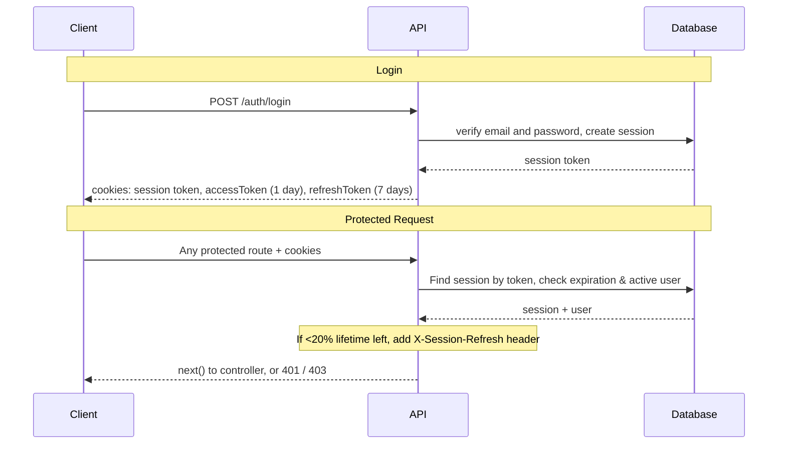
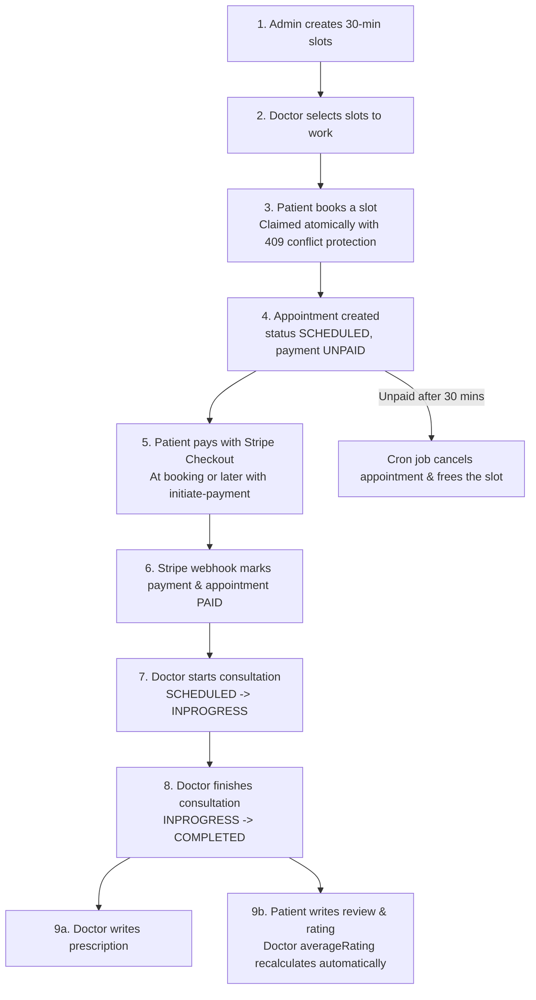

# Smart Healthcare Management System: Backend

REST API for an online doctor appointment platform. Patients find a doctor, book a time slot and pay with Stripe. Doctors manage their own availability, appointments, prescriptions and reviews. Admins and super admins run the platform.

## Features

- **Authentication**: Email/password and Google login, 2-minute email OTP verification, password change/forget/reset, session cookie + JWT access/refresh tokens
- **Role-based access**: `SUPER_ADMIN`, `ADMIN`, `DOCTOR`, `PATIENT`
- **Staff management**: Create doctors (with specialties) and admins, update, soft delete
- **Specialties**: Create (with icon upload to Cloudinary), list, delete
- **Schedules**: Admins generate 30-minute slots from a date/time range, doctors pick the slots they work
- **Appointments**: Book with Pay Now or Pay Later, safe against double booking, status transitions per role
- **Payments**: Stripe Checkout (currency: `BDT`), webhook with signature verification and duplicate-event protection
- **Auto cancel**: A background cron job (every 25 minutes) cancels unpaid appointments older than 30 minutes and frees the slot
- **Prescriptions**: A doctor writes one prescription per completed appointment
- **Reviews**: A patient reviews a completed appointment, and the doctor's average rating updates automatically

## Tech Stack

Express 5 · TypeScript · Prisma 7 (PostgreSQL, `@prisma/adapter-pg`) · Better Auth · Stripe · Cloudinary + Multer · Nodemailer · node-cron · Zod 4 · pnpm

## Getting Started

### Prerequisites
* Node.js 20+
* pnpm (`npm install -g pnpm`)
* PostgreSQL database
* Stripe, Cloudinary, and Nodemailer (Gmail App Password) accounts

### Installation

```bash
# 1. Install dependencies
pnpm install

# 2. Setup environment variables
cp .env.example .env    # Fill in your own secrets and database credentials

# 3. Generate Prisma client
pnpm generate

# 4. Run database migrations
pnpm migrate

# 5. Start development server
pnpm dev                # Starts on http://localhost:5000
```

For Stripe payment testing in development, forward webhook events:
```bash
pnpm stripe:webhook
```

### Available Scripts

| Script | What it does |
| --- | --- |
| `pnpm dev` | Run with hot reload (`tsx watch src/server.ts`) |
| `pnpm build` | Compile TypeScript into `dist/` |
| `pnpm start` | Run compiled production build from `dist/server.js` |
| `pnpm generate` | Generate Prisma client into `src/generated/prisma` |
| `pnpm migrate` | Run `prisma migrate dev` |
| `pnpm studio` | Open Prisma Studio GUI |
| `pnpm lint` | Run ESLint across `src/` |

---

## API Overview

Base path: `/api/v1`. The Stripe webhook is `POST /webhook` (outside the base path).

### Auth: `/api/v1/auth`

| Method | Path | Access | Description |
| --- | --- | --- | --- |
| POST | `/register` | Public | Register patient & send 2-min email OTP |
| POST | `/verify-email` | Public | Verify 6-digit email OTP |
| POST | `/login` | Public | Login (sets session, accessToken & refreshToken cookies) |
| GET | `/me` | Logged In | Get profile of logged-in user |
| POST | `/refresh-token` | Public | Refresh accessToken & extend session |
| POST | `/change-password` | Logged In | Change user password |
| POST | `/forget-password` | Public | Request password reset email |
| POST | `/reset-password` | Public | Reset password with token |
| POST | `/logout` | Logged In | Invalidate session & clear cookies |

### Staff & Specialties

| Method | Path | Access | Description |
| --- | --- | --- | --- |
| POST | `/users/create-doctor` | Admin, Super Admin | Create doctor with specialties |
| POST | `/users/create-admin` | Super Admin | Create admin or super admin |
| GET | `/doctors` | Public | Browse doctors (search, filter, pagination) |
| GET | `/doctors/:id` | Public | Get single doctor profile |
| PATCH, DELETE | `/doctors/:id` | Admin, Super Admin | Update or soft-delete doctor |
| GET, PATCH, DELETE | `/admins/:id` | Super Admin | Manage admin accounts |
| POST | `/specialties` | Admin, Super Admin | Create specialty with Cloudinary icon |
| GET | `/specialties` | Public | List all active specialties |
| DELETE | `/specialties/:id` | Admin, Super Admin | Soft-delete specialty |

### Schedules & Availability

| Method | Path | Access | Description |
| --- | --- | --- | --- |
| POST | `/schedules` | Admin, Super Admin | Generate 30-min schedule slots |
| GET, DELETE | `/schedules`, `/:id` | Admin, Super Admin | View or delete schedule slots |
| POST | `/doctor-schedules/create-my-doctor-schedule` | Doctor | Doctor selects available slots |
| GET | `/doctor-schedules/my-doctor-schedules` | Doctor | Doctor views own working slots |
| DELETE | `/doctor-schedules/delete-my-doctor-schedule/:id` | Doctor | Delete unbooked working slot |

### Appointments: `/api/v1/appointments`

| Method | Path | Access | Description |
| --- | --- | --- | --- |
| POST | `/book-appointment` | Patient | Book appointment (Pay Now, returns Stripe URL) |
| POST | `/book-appointment-with-pay-later` | Patient | Book appointment (Pay Later) |
| POST | `/initiate-payment/:id` | Patient | Get Stripe Checkout link for Pay Later booking |
| GET | `/my-appointments` | Patient, Doctor | List personal appointments |
| GET | `/my-single-appointment/:id` | Patient, Doctor | View appointment details |
| GET | `/all-appointments` | Admin, Super Admin | View all platform appointments |
| PATCH | `/change-appointment-status/:id` | Roles | Transition appointment status |

### Prescriptions & Reviews

| Method | Path | Access | Description |
| --- | --- | --- | --- |
| POST | `/prescriptions` | Doctor | Write prescription for completed appointment |
| GET | `/prescriptions/my-prescriptions` | Patient, Doctor | View personal prescriptions |
| GET | `/prescriptions/:id` | Owner, Admin | Get single prescription |
| PATCH | `/prescriptions/:id` | Author Doctor | Update prescription instructions |
| POST | `/reviews` | Patient | Review completed appointment (rating 1–5) |
| GET | `/reviews/doctor/:doctorId` | Public | Read reviews of a doctor |
| GET | `/reviews/my-reviews` | Patient, Doctor | View personal reviews |

---

## Architecture & Visual Flows

### JWT & Session Authentication Flow



### Booking & Concurrency Flow



---

## Project Structure

```
├── prisma/
│   ├── migrations/          # Version-controlled SQL database migrations
│   └── schema/              # Multi-file Prisma schemas (one per model)
├── src/
│   ├── app.ts               # Express application, Stripe raw webhook, global middlewares
│   ├── server.ts            # Server entrypoint, database connect, graceful shutdown
│   └── app/
│       ├── config/          # Central environment config, Cloudinary, Multer, Stripe
│       ├── errorHelpers/    # Custom AppError class
│       ├── interfaces/      # Global & request interfaces
│       ├── lib/             # Better Auth instance, Prisma client with @prisma/adapter-pg
│       ├── middleware/      # checkAuth, validateRequest, globalErrorHandler, notFound
│       ├── routes/          # Central route registry (index.ts)
│       ├── shared/          # catchAsync, sendResponse
│       ├── utils/           # Cookie, JWT, email, password hashing utilities
│       └── module/          # Domain-driven feature modules
│           ├── admin/
│           ├── appointment/
│           ├── auth/
│           ├── doctor/
│           ├── doctorSchedule/
│           ├── prescription/
│           ├── review/
│           ├── schedule/
│           ├── specialty/
│           └── user/
├── package.json
├── prisma.config.ts         # Prisma 7 configuration file
└── tsconfig.json
```

---

## License
ISC
